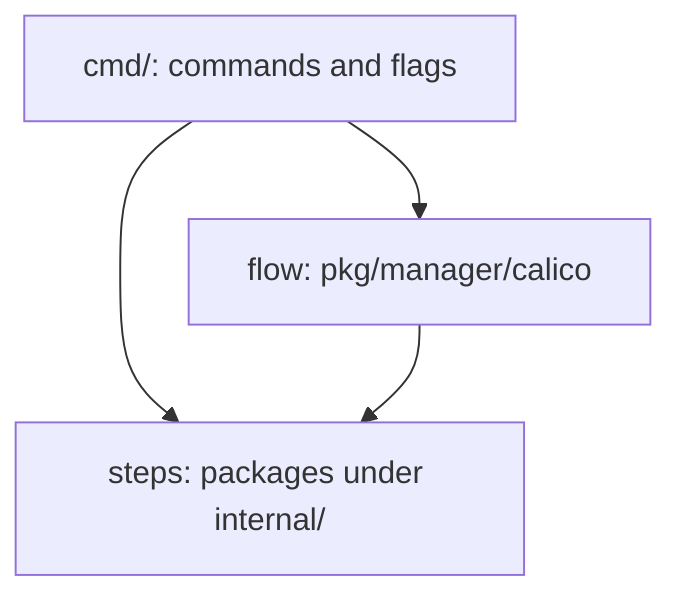
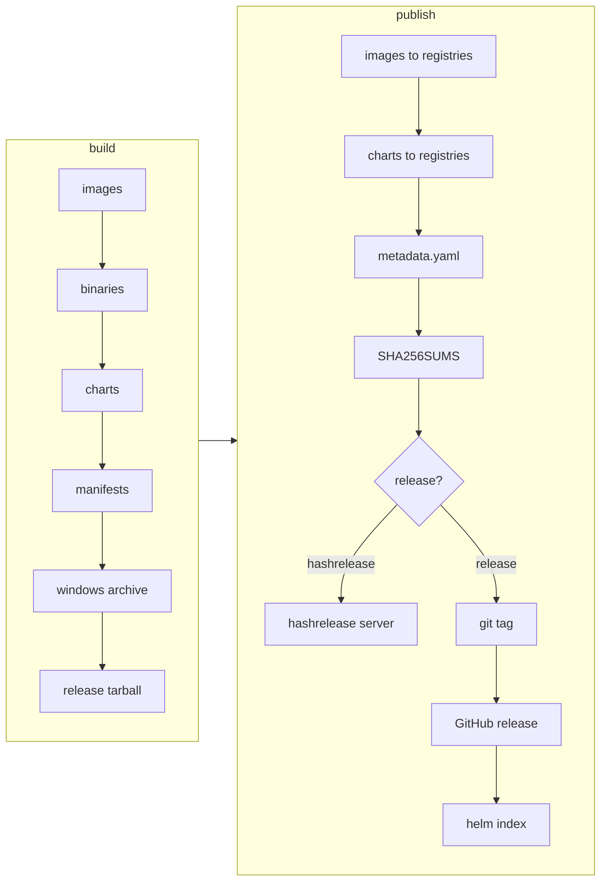

# Release tooling — design

## Overview

`release/` builds the `release` CLI. It does three jobs:

- **Branch cut:** creates a release branch and the dev tags that go with it.
- **Release:** builds an official version from a release branch and publishes it
  to registries and download locations.
- **Hashrelease:** builds a pre-release of one commit, named by its git hash,
  and publishes it to the hashrelease server for testing.

A release and a hashrelease run the same code in two phases.

1. **Build** makes the artifacts locally.
2. **Publish** pushes them out in a fixed order and records what it pushed.

The code has three layers:

- `cmd/` turns commands and flags into values.
- The **flow** decides what runs and in what order.
- **Steps** do the work. Each one owns one kind of output.

The sections below cover those layers, then the rules that make publishing safe
to repeat. This file records what the code promises: the model, the order rules,
and the invariants a change must keep. How to run a release or a hashrelease is
in [`RELEASING.md`](RELEASING.md).

## Model: steps, verbs, and the flow

A **step** is a package under `internal/` that owns one kind of output:
`images`, `charts`, `operator`, `binaries`, `archives`, `manifests`,
`distribution`. Its **verbs** are package functions, and each step has only the
verbs it needs. For example, `images` has `Build`, `Publish` and `Resolve`,
while `archives` only builds.

- A verb takes a value that describes the output (an `Archive`, a `Chart`, an
  `Operator`) and options. It checks the value before it runs any command, and
  reports every problem at once.
- Each verb has its own option type. A verb rejects, at compile time, an option
  it does not use.
- A verb does the work. It never decides whether it should run. Flags, `--skip`
  and release-or-hashrelease gating belong to the caller.
- A difference between a release and a hashrelease reaches the verb as config (a
  directory, a registry, a URL), not as a hashrelease flag. Some verbs predate
  this rule and still take one, such as `operator.Build` and `operator.Publish`.
- Every step embeds `steps.Step`, which carries the command runner, working dir,
  step name and logs dir. The zero value runs real commands. Tests swap the
  runner.
- Log lines carry the step name. Each command a step runs logs to
  `<logsDir>/<step>/<slug>.log`, so a failed component's log can be found
  without reading the whole run.

The **flow** (`pkg/manager/calico`) builds step values from flags and calls
verbs in order. The manager predates the step packages and still does some work
itself. New behaviour goes into a step package; the manager keeps only building
values and choosing order.

`cmd/` maps CLI commands and flags onto the flow and onto single-step commands
(`release images publish`, `release charts build`). A single-step command and
the flow build the same step value from the same flags.

## Order of a run

The upload list built by `CalicoManager.uploads`, in order. A change can add or
move steps, as long as it keeps the rules below the diagram.

Publishing is an ordered list of uploads (`distribution.Upload`). The rules that
set the order:

- Registries publish before `metadata.yaml` is written, because metadata records
  the digests they produced.
- An index goes after everything it names. An index that names a missing file
  breaks its clients. The helm index goes last, since it points at GitHub
  release download URLs.
- `SHA256SUMS`, if written, is the last write into the upload directory, so it
  covers `metadata.yaml` and every other file there.
- The list stops at the first failure, since a later upload may depend on an
  earlier one. Each upload checks its source when it runs, not up front, because
  an earlier upload may create it.

## Re-runs and records

A release that fails partway is fixed and run again. Every publish verb must be
safe to repeat: it either proves its effect already exists and skips it, or
repeating it costs nothing.

- Each publish appends the refs it pushed, as `registry/repo:tag@sha256:digest`,
  to a per-step record under `outputs.RecordsDir`. The record sits outside the
  upload directory, so nothing in it is published. Its ID must not change
  between reruns of one release.
- A ref is written and synced as soon as it is pushed, and before a failure is
  reported. A partial run is the one whose record decides what a resume still
  has to do.
- On a rerun, a verb skips what the record and the registry both show as
  published. A failed registry lookup is not proof that something is missing.
- A dry run records nothing. It reached no registry, so a record would claim
  images that do not exist.
- Code that changes the git tree during a build puts it back before the run
  moves on, on the failure path too. The step that made the change is the best
  place to undo it.

## What a release records

`metadata.yaml` describes what shipped: source, components, charts and
downloadable artifacts. It is built from the step records, and falls back to the
registry for a digest no record holds. A release requires every digest; a
hashrelease does not.

Everything a release publishes is named by digest, not only by tag. Anything
that later verifies or signs the release works from those digests, so it covers
exactly what was pushed.

`metadata.yaml` lists every download with its URL and sha256. A download left
out of it is not covered by anything that reads the file later. A package
repository is not a download: its signed index covers its packages.

`CalicoManager.uploads` writes `SHA256SUMS`, so a user can check a download with
`sha256sum -c --ignore-missing SHA256SUMS`. `internal/gpg` signs packages and
verifies each signature before it returns. A signature that cannot be verified
fails the sign, not a later check.

## Remote changes and `--local`

`--local` runs local work as normal and turns every remote change into a dry
run. Reads still happen.

- One run-level value feeds every step's dry run. Do not add a per-step dry-run
  flag.
- Each remote change a dry run skips logs one line that starts `Dry run,`, as in
  `Dry run, not publishing helm charts`, so a rehearsal's log lists what a real
  run would change.
- Each tool keeps its own dry-run form (`git push --dry-run`, a make variable, a
  skipped push). A runner that drops commands does not fit, since reads must
  still run.
- A verb that pushes takes its go-ahead as an argument, not an option, so a
  caller cannot forget it and push by default.
- A lookup of what this run would have pushed must let only-missing items pass
  with a warning under `--local`, since nothing was pushed. Any other lookup
  failure still fails.

## Defaults and swap points

A setting resolves in this order: flag, then environment variable, then
`metadata.mk`, then a fallback var in `internal/defaults`. `make build` embeds
the repo's `metadata.mk` in the binary (build tag `with_embed`). Without the
tag, as in `go test` or `go run`, the binary reads `metadata.mk` from the git
root at run time. `internal/defaults` must not import `internal/utils`: an
`init()` that sets its vars may import `utils`, and the cycle would break that
build, not this one.

Org, repo, registries, image dirs, make targets and validation funcs live in
package-level vars, so a fork or a test can change them without editing the code
that reads them. The rules:

- Declare the var in the file that uses it, with this repo's value. Code reads
  the var. Never inline the literal.
- To change one, set it in an `init()`. "Var" covers a field of a var and a map
  entry too.
- A func var replaces the default whole; it is not an append hook. To extend a
  default, save the old value first and call it from the new one.
- Clone a slice var before appending to it, or the append can write into the
  shared backing array.
- Removing, renaming or re-typing one changes behaviour for whatever sets it.
  Find those first and decide the change on purpose.

## Concurrency and retries

- `steps.Go` and `steps.GoLimit` run one function over many items. Results come
  back in input order, and every error is joined, not just the first.
- Anything shared across those goroutines is serialised by its owner (the refs
  writer locks its file).
- A step owns its retry (`steps.MaxRetries`). Callers do not wrap a step in
  another retry, since retries multiply and some actions, like a git tag, are
  not safe to repeat.

## Branch cut

`internal/branch` cuts a release branch. A cut resolves into a `CutPlan`, then
runs a list of check-then-act steps: `Done` probes whether the effect exists,
`Do` makes it. So a cut can be printed before it runs, skipped by step name, and
resumed. Repo-specific work plugs in through func fields on `Driver`, not by
changing the steps.

## Do's and Don'ts

- Do put new behaviour in a step package. Don't add it to the manager when it
  could be a step verb.
- Don't make a verb check flags, `--skip`, or a hashrelease boolean. Gating
  belongs to its caller.
- Do make every publish verb safe to rerun, and record refs before reporting a
  failure (Re-runs and records).
- Don't publish to a registry after `metadata.yaml`, write an index before what
  it names, or write into the upload dir after `SHA256SUMS` (Order of a run).
- Do list every new download in `metadata.yaml` (What a release records).
- Don't inline an org, registry, repo or component list. Don't remove, rename or
  re-type a swap-point var before finding who sets it (Defaults and swap
  points).
- Don't add a retry around a step, or a per-step dry-run flag, without a reason.
