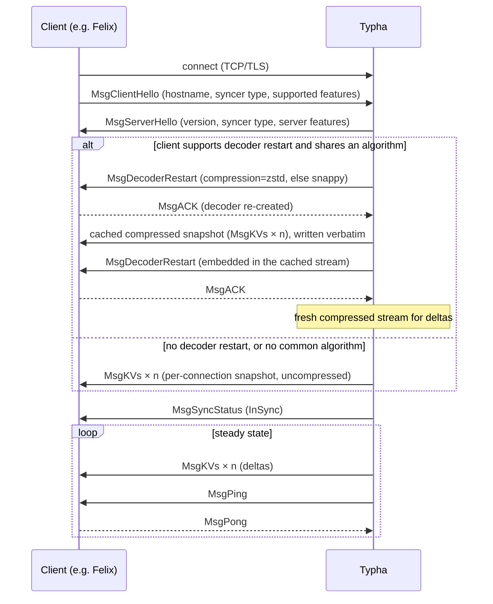

<!--
Copyright (c) 2026 Tigera, Inc. All rights reserved.

Licensed under the Apache License, Version 2.0 (the "License");
you may not use this file except in compliance with the License.
You may obtain a copy of the License at

    http://www.apache.org/licenses/LICENSE-2.0
-->

# Typha wire protocol

Applies to: `typha/pkg/syncproto/**` — and to any change, on
either side, to what goes on the wire.

The protocol is defined (structs and a long design comment) in
`typha/pkg/syncproto/sync_proto.go`. This doc covers the same
ground at design level: the handshake, the encoding choices and
their consequences, and the version-skew rules. The server and
client implementations are covered in [`server.md`](./server.md)
and [`client.md`](./client.md).

## Shape of the protocol

The client opens a TCP connection (default port 5473, usually
TLS — see [`client.md`](./client.md)) and the two sides exchange
gob-encoded messages, each wrapped in an `Envelope` struct to
simplify decoding. The client speaks first (`MsgClientHello`);
after the server's `MsgServerHello`, the stream is almost
entirely server→client: a complete snapshot of the datastore as
`MsgKVs` messages, `MsgSyncStatus` when the status changes
(typically `InSync` once the snapshot is done), then a live feed
of further `MsgKVs`/`MsgSyncStatus`. The only steady-state
client→server traffic is `MsgPong` replying to the server's
periodic `MsgPing`.

There is no goodbye message: either side disconnects by closing
the connection, and the client treats any disconnection the same
way (reconnect and resync — see [`client.md`](./client.md)).

The handshake also selects the stream contents: `MsgClientHello`
names a `SyncerType` (`felix`, `bgp`, `tunnel-ip-allocation`,
`node-status`; unset means `felix`, for old clients) and the
server attaches the connection to that type's pipeline.

## KV encoding: gob envelope, "default path" key, JSON value

Key/value pairs are not gob-encoded as Go structs. Each is a
`SerializedUpdate`: the key flattened to its libcalico-go
"default path" string (`model.KeyToDefaultPath` — the etcd key
format) and the value serialized to JSON (`model.SerializeValue`
— the etcd value format), plus the syncer metadata (revision,
update type, TTL). The rationale, from the package comment:

1. it avoids any subtle incompatibility between our datamodel
   and gob;
2. it removes the need to register all our datatypes with the
   gob encoder/decoder;
3. it re-uses known-good serialization code with known semantics
   around data-model upgrade (the JSON marshaller's treatment of
   added/removed fields);
4. it allows each KV pair to be serialized **once** and sent to
   all listening clients — not easy in raw gob, because a gob
   connection is stateful.

One subtlety: Typha suppresses updates that don't change the
value (`WouldBeNoOp`) — this is how kubelet's node-heartbeat
churn dies at Typha rather than fanning out. v3 resources carry
their resource version *inside* the object, which would defeat
the value comparison, so `SerializeUpdate` moves it out into the
`V3ResourceVersion` field before serializing.

Gob sends type information inline, per connection, which
prevents splicing pre-encoded streams (see below). We keep it for
compatibility; the decoder-restart mechanism is the escape hatch
to a future encoding.

## Feature negotiation and decoder restart

Gob defaults unknown fields to their zero value, so feature
negotiation is just booleans in the Hello messages: if the peer
didn't say `SupportsFeatureX: true`, you see `false`. Sending a
message *type* the peer doesn't know, however, makes its decoder
return an error and kills the connection — hence the cardinal
rule below.

The one thing simple negotiation can't do is change the encoding
mid-stream, because gob is stateful: it assigns per-connection
type IDs, so you cannot splice one gob stream after another —
the receiver rejects the duplicate type info or misparses. This
blocked the obvious "serialize the snapshot once, replay the
bytes to every client" optimisation, and is why the protocol has
`MsgDecoderRestart`/`MsgACK`:

- `MsgDecoderRestart` is the last message of the old stream: the
  server closes the stream straight after it. The client discards
  its decompressor and gob decoder and builds fresh ones for the
  algorithm named in the message.
- The client replies `MsgACK` **before** the server sends any
  data in the new format. This ordering is mandatory: an
  un-restarted decoder may eagerly buffer bytes it can't parse.

The server uses this twice per modern connection (see diagram):
once after the handshake to hand the connection to the cached
snapshot — a self-contained compressed gob stream, generated once
per syncer type and algorithm and replayed verbatim to every
concurrently-connecting client — and once at its end, which the
cached stream carries itself.

Only the server→client stream is compressed; client messages are
small. The client advertises its algorithms in
`SupportedCompressionAlgorithms` and the server picks the first in
its own preference order: zstd (roughly half snappy's output — see
[`compression-analysis.md`](../docs/compression-analysis.md)),
then snappy for older clients. Streams carry no terminator, so the
restart boundary rests on the `syncproto.Compressor`/`Decompressor`
contract: a stream ends on its last byte of data, and a
decompressor never reads past it.

## Version skew and upgrading the datamodel

Typha parses resources and then re-serializes them, so a mixed
Typha/client version pair effectively intersects their
datamodels. The package comment spells out the cases; in brief:

- **New field:** stripped at parse time by whichever side is
  older; behaviour degrades to old-Felix behaviour, provided the
  field was added in a back-compatible way.
- **New resource type:** old Typha won't send it (client must
  tolerate absence); old client fails to parse it, and the client
  code drops the KV with a rate-limited log.
- **Replacing one synthesized resource with another** does *not*
  work across skew — the new one is stripped, the old one no
  longer sent. That needs handshake gating.

Two hard rules fall out of Typha's pass-through role:

- **Typha must not transform values** — parse, validate (which,
  in etcd mode, applies CRD schema defaults as the API server
  would), re-serialize, nothing else — without a deliberate
  version-skew design and a good reason. Felix config is
  especially prone:
  Felix restarts itself when its config "changes", so Typha must
  deliver exactly the config Felix would have loaded itself, or
  a Typha upgrade triggers a fleet-wide Felix restart loop.
- **Synthesized resources must round-trip.** Resources
  synthesized by the Kubernetes datastore driver are never
  written to etcd, but they still travel the Typha wire, so they
  must serialize/deserialize like everything else.

## Review notes

- **Never send a message type (or enum value with new
  semantics) the peer hasn't advertised support for.** New
  message types need a `Supports…` field in the Hello and a
  check before sending. The two hard-reject examples of the
  inverse — server refusing clients without
  `SupportsModernPolicyKeys`, client refusing servers without
  `SupportsNodeResourceUpdates` — are deliberate, documented
  minimum-version gates.
- **`gob.RegisterName` names are frozen** — they use the
  pre-monorepo `github.com/projectcalico/typha/...` paths so that
  refactors don't break the wire format. Never "fix" them, and
  register new message types the same way.
- **No new-format bytes before the `MsgACK`** when restarting
  the decoder, and the server must hold off pings while waiting
  for the ACK (the pinger writes to the same stream).
- **Peers are untrusted across compression.** The client drops
  the connection if a restart names an algorithm it didn't
  advertise, and its zstd decoder caps the frame window (encoders
  stay well under the cap); the server never decompresses client
  data.
- A change to `SerializedUpdate` fields or to `WouldBeNoOp` is a
  change to the dedupe and version-skew behaviour — think
  through both upgrade directions, and remember `WouldBeNoOp`
  must keep ignoring revision-only changes or the kubelet
  heartbeat suppression breaks.
- A datamodel change that renames/re-keys resources needs the
  "upgrading the datamodel" cases in `sync_proto.go` walked
  through explicitly in the PR.

## Siblings that move with this doc

- The protocol doc comment in `pkg/syncproto/sync_proto.go` — the
  symbol-level source of truth — whenever a message, the
  handshake, or negotiation changes.
