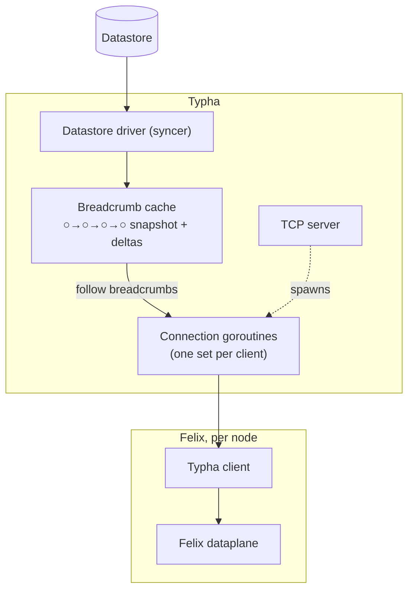
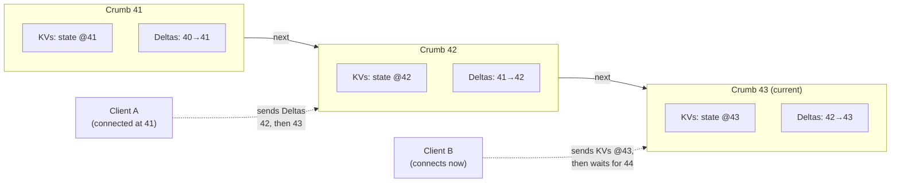
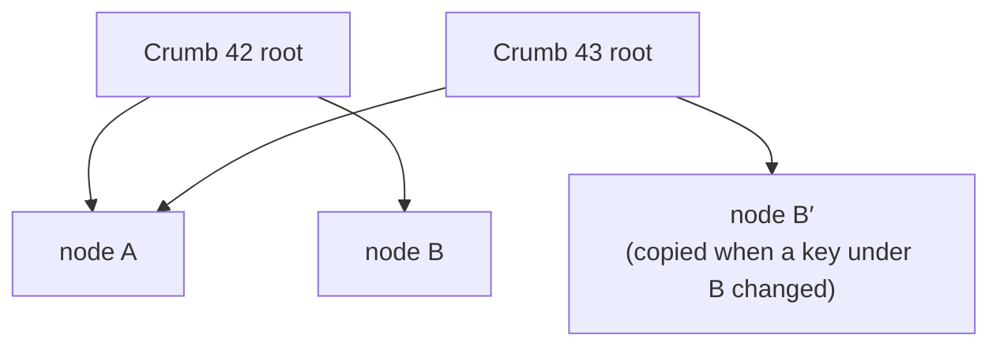

<!--
Copyright (c) 2026 Tigera, Inc. All rights reserved.

Licensed under the Apache License, Version 2.0 (the "License");
you may not use this file except in compliance with the License.
You may obtain a copy of the License at

    http://www.apache.org/licenses/LICENSE-2.0
-->

# Typha server

Applies to: `typha/pkg/daemon/**`, `typha/pkg/calc/**`,
`typha/pkg/validator/**`, `typha/pkg/snapcache/**`,
`typha/pkg/syncserver/**`, `typha/pkg/k8s/**`,
`typha/pkg/config/**`.

The server side of Typha is a pipeline from the datastore to many
TCP connections:



The interesting design problem is in the middle: a new client
needs the *whole* datastore snapshot (hundreds of thousands of
KVs in a big cluster) while the update stream keeps flowing
(bursts of ~1,000 updates/s), and hundreds of clients may connect
at once. The breadcrumb cache and the shared binary snapshot are
the two mechanisms that make that cheap.

## The daemon and its pipelines

`daemon.TyphaDaemon` (`pkg/daemon/daemon.go`) loads config
(Felix-style env-var/file layering, `pkg/config`), connects to
the datastore, and builds one pipeline per `SyncerType`:

```
syncer → SyncerCallbacksDecoupler → ValidationFilter
       [→ NodeCounter, felix pipeline only]
       → SyncerCallbacksDecoupler → snapcache.Cache
```

- The syncers come from `libcalico-go/lib/backend/syncersv1/`
  (see [`design/syncer/DESIGN.md`](../../design/syncer/DESIGN.md)
  for the API contract, which each pipeline stage must preserve).
- `calc.SyncerCallbacksDecoupler` moves the stream onto another
  goroutine via an **unbuffered** channel. That's deliberate:
  it buys pipeline parallelism (downstream can process one batch
  while upstream produces the next) without adding a queue — once
  the cache's small input buffer (`2×MaxBatchSize` batches) is
  full, backpressure reaches the syncer, and the backlog
  accumulates in the datastore watcher, which can coalesce it.
- `calc.ValidationFilter` validates each value and **nils out
  invalid ones** (treating them as deletions): one bad resource
  in the datastore must not take out every Felix. v1-model values
  are checked by `pkg/validator/v1` (dataplane validity, not API
  validation); v3 resources by the API validator, which in etcd
  mode also applies CRD schema defaults in place, as the API
  server would on admission. (Felix runs an equivalent
  `ValidationFilter` in `felix/calc`, so the direct-datastore
  path behaves the same.)
- `calc.NodeCounter` (felix pipeline only) counts Node resources
  in passing; the connection governor uses it (below).

The caches are handed to a single `syncserver.Server`, which
routes each connection to the cache matching the `SyncerType`
requested in its handshake.

### Review notes

- A new pipeline stage sits inside the Syncer API contract: it
  must preserve deletions, keep `UpdateType` sequences coherent,
  and must not reorder a key's updates. Its output must be a
  **safe approximation** of its input: eliding intermediate
  states is fine, claiming more than it knows is not.
- Don't add buffering to the decouplers "for throughput" — the
  no-queue backpressure is a design choice; queues here just move
  the backlog somewhere it can't be coalesced.
- `ValidationFilter` may nil out a value and, in etcd mode, apply
  CRD defaults; it must never otherwise "fix up" a value (see the
  pass-through rule in [`protocol.md`](./protocol.md)).

## The breadcrumb cache (`pkg/snapcache`)

The obvious cache — a big map guarded by a mutex — fails at
scale: sending (or copying) a 500k-entry snapshot to a new client
while holding the lock starves the writer. Instead, the cache
publishes a linked list of immutable **breadcrumbs**. Crumb *N*
holds two things:

- **`KVs`** — the *complete* datastore state as of crumb *N*: one
  entry per key, already serialized (serialize once, send many
  times; see [`protocol.md`](./protocol.md)). It is not a history.
- **`Deltas`** — a plain slice of the updates that turned crumb
  *N−1*'s state into crumb *N*'s.



A client's goroutine takes whichever crumb is current when it
connects, sends that crumb's `KVs` as its snapshot, then follows
the `next` pointers sending only each crumb's `Deltas`. Each client
walks the list at its own pace; the writer never waits for
readers. Following an existing `next` pointer is a lock-free
atomic load; a client that reaches the head blocks on one shared
condition variable until the next crumb is published. Crumbs no
client references any more are garbage collected.

Giving every crumb a full snapshot is affordable because `KVs` is
a **copy-on-write B-tree**. The cache's single main goroutine
applies each batch (up to `MaxBatchSize`, default 100 updates) to
its working tree, then `Clone()`s it into the new crumb. A clone
shares every node with the original, so it costs O(1) regardless
of tree size; the writer's later changes copy only the nodes on
the path they touch:



Per-client channels were rejected: keeping one slow client from
blocking the rest needs skipping and per-channel progress
tracking, which is fiddlier than letting each client walk an
immutable list.

The cache massages the stream so that what a late-joining client
sees is still a valid syncer stream:

- Snapshot entries are rewritten to `UpdateTypeKVNew` — for a
  new client every KV *is* new — while deltas keep their real
  type, keeping downstream stats eventually consistent.
- No-op updates (same value, different revision) are dropped;
  this is where the kubelet-heartbeat firehose dies.
- Deletions are forwarded even when the tree doesn't hold the
  key. Update types are minted upstream (the `watchersyncer`'s
  per-key cache) against the **raw** view; the tree holds the
  **validated** view, from which `ValidationFilter`'s nil-ing of
  an invalid value drops the key. A real deletion can therefore
  arrive for a tree-absent key, and downstream `New`/`Deleted`
  refcounts (Felix's stats collector) only stay balanced if it is
  passed through.
- `InSync` is only attached to the **last** crumb of a batch —
  a mid-batch crumb doesn't yet reflect everything the syncer
  told us, and claiming in-sync early would trigger premature
  dataplane programming in Felix.

### Review notes

- Publishing crumb *N* sets two pointers, under the
  condition-variable lock and in this order: crumb *N−1*'s `next`,
  then the cache's current crumb. A new client starting at the
  current crumb therefore never sees a crumb that older clients
  can't reach by walking `next`. Don't reorder, and don't touch a
  published crumb — every field is immutable once it is visible.
- Nothing may block the cache's main goroutine: no locks shared
  with per-client work, no I/O. It is the only writer.
- The safe-approximation doctrine (above) applies to every
  transformation here: delaying `InSync` is always safe; claiming
  it early never is. Eliding states is fine only if `UpdateType`
  is rewritten so each client's view stays self-consistent.
- `Cond.Wait` has no timeout in Go, hence the cache's periodic
  wake-up ticker so blocked readers can notice a dead connection
  (context cancelled). Don't remove it as "unused".

## The sync server (`pkg/syncserver`)

`syncserver.Server` accepts connections (TLS if configured —
mutual authentication is covered in [`client.md`](./client.md))
and runs a small goroutine set per connection: a reader (drains
client messages onto a channel), and — once the snapshot has been
sent — a KV-sender following the breadcrumb trail and a pinger. The
per-connection context ties them together: any of them failing
cancels the lot, and the client is expected to reconnect
(possibly to another Typha).

Liveness is application-level: the server pings every
`PingInterval` (10s) and drops the connection if no pong arrives
within `PongTimeout` (which also bounds each decoder-restart ACK
wait). The pinger writes through the same lock as the KV-sender.
Mid-snapshot only the write deadline protects the server; the
pong check starts with the delta stream. Two deliberate wrinkles,
both from load testing:

- The write deadline is set to 1.1×`WriteTimeout` ahead and only
  pushed out again once less than `WriteTimeout` remains —
  calling `SetWriteDeadline` per message showed up in profiles.
- While streaming the shared snapshot, a write that times out
  after sending some bytes is resumed from where it stopped, with
  a fresh deadline; only a write that sends nothing kills the
  connection. The deadline thus detects a stalled client rather
  than capping a huge snapshot's total send time.

### New-client snapshots: streamed vs shared

How a new client gets its snapshot depends on the negotiated
features (see [`protocol.md`](./protocol.md) for the wire-level
sequencing):

- **Legacy path:** the KV-sender iterates the current crumb's `KVs` and
  gob-encodes every KV to that one client. Cost: a few seconds of
  CPU per client at 500k KVs — fine for one client, ruinous for a
  thundering herd (500 clients ≈ 25 CPU-minutes, i.e. tens of
  minutes of wall clock on typical Typha CPU allocations).
- **Shared path** (`snap_precalc.go`): the first arriving client
  for a given syncer type and compression algorithm triggers a
  background goroutine that serializes the current crumb into an
  in-memory buffer, as a self-contained compressed gob stream
  ending in `MsgDecoderRestart`; every matching client that
  arrives while that snapshot is "active" replays the same bytes
  (`multireadbuf` lets readers stream while the writer is still
  appending). Once written, the snapshot stays active for
  `BinarySnapshotTimeout` (default 1s) *and* until a newer crumb
  exists — no point regenerating identical bytes. The herd cost
  collapses to one serialization plus N byte-copies.

`typha_snapshots_generated` vs `typha_snapshots_reused` and the
raw/compressed size metrics (labelled by syncer and compression)
monitor this mechanism.

### Slow clients: fall-behind and the grace period

A client that consumes crumbs slower than the cache produces them
falls progressively behind; its (immutable, shared) crumbs pin
memory. The KV-sender compares its crumb's timestamp with the
latest crumb's and disconnects the client if the gap exceeds
`MaxFallBehind` (default 300s) — reconnecting to a fresh snapshot
is cheaper than replaying a long backlog. Two softenings:

- **Catch-up batching:** a behind client's sender merges deltas
  from multiple crumbs into bigger messages until it catches up,
  so mild lag self-heals.
- **New-client grace period** (`NewClientFallBehindGracePeriod`,
  default 300s): right after sending a snapshot a slow client is
  inevitably "behind"; disconnecting it just repeats the
  snapshot. The code comment notes the secondary effect: under
  extreme overload, the grace period lets Felix keep applying
  updates to the dataplane — slow progress beats a
  connect/snapshot/drop loop that makes none.

The long defaults here, `PongTimeout`, and the client's read
timeout all follow one doctrine: at high scale, a false-positive
disconnect under load is worse than a slow recovery, because mass
disconnection re-triggers the thundering herd that caused the
load.

### Connection governance

A fleet of Typhas has no coordinator; balance is server-driven.
When `ConnectionRebalancingMode` is `kubernetes` (as set in the
shipped manifests; the bare-config default is `none`), each Typha
polls the EndpointSlices of its own Service for the Typha count
(ready or not), takes the node count from the felix pipeline's
`NodeCounter`, and computes a connection cap
(`k8s.CalculateMaxConnLimit`): fair share per Typha assuming
`numTyphas-1` replicas (tolerating one death mid-upgrade), +20%
headroom, clamped to configured bounds. Over the cap, it drops
**one random connection per `DropInterval`** (default 1s).
Random-drop was chosen for simplicity, and the drop is
rate-limited so that a bad cap calculation has a small blast
radius; Typha has plenty of headroom, so converging slowly is the
safe trade-off. Dropped clients reconnect via discovery and land
somewhere less loaded (see [`client.md`](./client.md)).

Graceful shutdown (SIGTERM) is the same mechanism with a
deadline: drain connections one at a time, pacing the drops to
finish within `ShutdownTimeout` (default 300s), so a Typha
rolling upgrade sheds clients gradually instead of dumping them
on the survivors at once.

Inbound messages are size-capped (1 MiB) to bound memory against
a misbehaving client; handshakes have their own timeout.

### Review notes

- Anything touching disconnect/timeout logic must honour the
  false-positives-are-worse doctrine above. Tightening a timeout
  needs field-scale justification, not just a faster test.
- The governor must stay rate-limited and cap-clamped; changes
  that let it shed many connections at once recreate the
  thundering herd it exists to prevent.
- The shared-snapshot lifecycle (create once, share while
  active, expire only after timeout *and* a newer crumb) is easy
  to break into "regenerate per client" without failing any
  test — watch `typha_snapshots_reused` in any change here.
- Per-connection goroutines may only *read* published crumbs;
  state shared between connections belongs in the cache or the
  server, under its existing locks.
- `syncserver.Config` fields get logged at Info — never add a
  secret to it (comment on the struct).

## Health, metrics, debug

Each cache reports readiness (`Ready` = `InSync`) and the server
liveness to the shared health aggregator (`/readiness`,
`/liveness`, port 9098) — so a Typha that hasn't synced with the
datastore stays unready and clients aren't steered to it.
Prometheus metrics (port 9093) cover the cache (crumb sequence,
sizes, update counts), per-syncer connection counts/latencies,
ping RTT, and the snapshot counters mentioned above. SIGUSR1
dumps a heap profile; `DebugPort` enables pprof.
